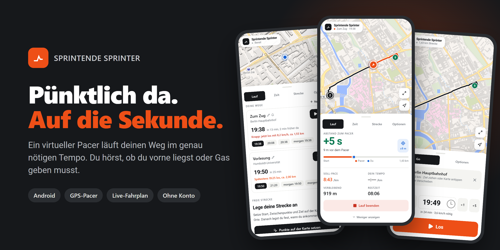
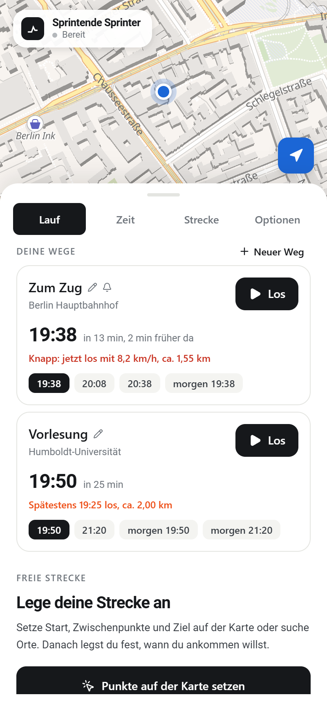
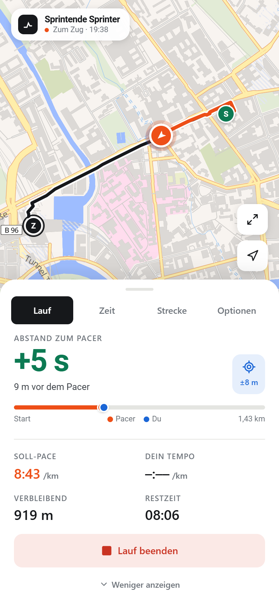
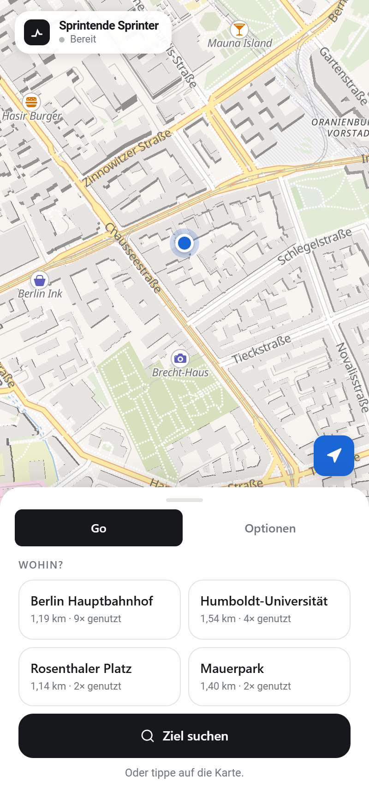
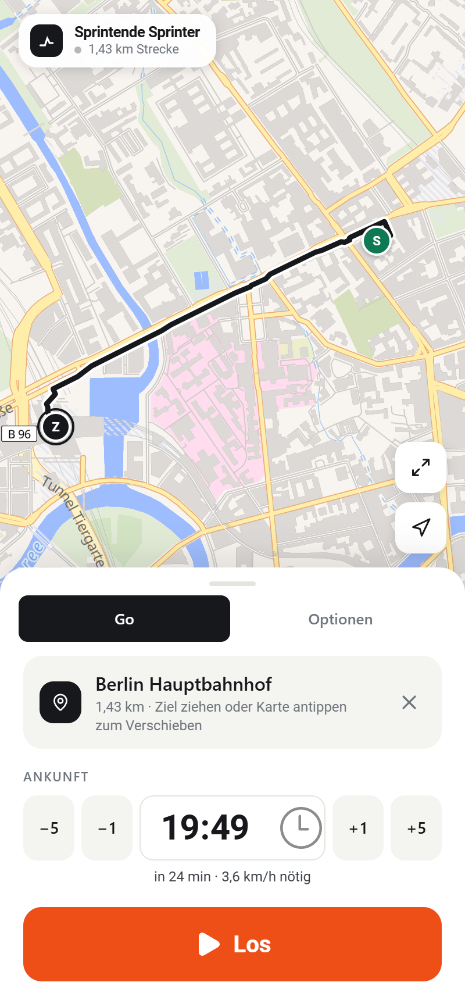

<p align="center">
  
</p>

<p align="center">
  <a href="https://github.com/theStxve/sprintende-sprinter/actions/workflows/ci.yml"></a>
  
  
  
  
  
  
</p>

<p align="center">
  <b>Zum Zug, zur Vorlesung, zum Date: genau rechtzeitig da, ohne zu früh zu hetzen oder zu spät zu kommen.</b>
</p>

---

**Sprintende Sprinter** ist eine Android-App für alle, die knapp dran sind. Du sagst, wohin und bis wann. Ein virtueller **Pacer** läuft die Strecke im exakt nötigen Tempo ab. Per GPS siehst und hörst du, wie viele Sekunden du vor oder hinter ihm liegst. Bleibst du vor ihm, bist du pünktlich.

## Screenshots

<table>
  <tr>
    <td align="center" width="25%"><br><sub><b>Wege</b><br>Nächste Abfahrt, spätestens-los-Zeit</sub></td>
    <td align="center" width="25%"><br><sub><b>Lauf</b><br>Abstand zum Pacer, live</sub></td>
    <td align="center" width="25%"><br><sub><b>Go-Modus</b><br>Häufige Ziele mit einem Tipp</sub></td>
    <td align="center" width="25%"><br><sub><b>Go-Modus</b><br>Ankunft setzen, Los</sub></td>
  </tr>
</table>

## Funktionen

| | |
| --- | --- |
| **Pacer** | Läuft deine Strecke im genau nötigen Tempo. Abstand in Sekunden und Metern, Soll-Pace, eigenes Tempo, Restdistanz, Restzeit. Zielerkennung mit Ergebnis. |
| **Wege** | Gespeicherte Ziele mit Uhrzeiten, z. B. „Zum Bahnhof, 13:04 am Gleis“. Ein Tipp startet den Pacer von deinem Standort. Die nächste Zeit wird vorgeschlagen, mit Puffer und Hinweis „spätestens um … los“. |
| **Go-Modus** | Für echte Eile. Statt aller Reiter eine einzige Ansicht: oft genutztes Ziel antippen, bei Bedarf auf der Karte verschieben, Ankunft per ±1/±5 min setzen, **Los**. In den Optionen einschaltbar. |
| **Zug-Verknüpfung** | Haltestelle, Linie und Richtung verknüpfen. Live-Verspätung, Gleis und Ausfälle fließen direkt in die Zielzeit ein. |
| **Erinnerungen** | An gewählten Wochentagen „In 5 min los …“ mit Los-Knopf. Ein Hintergrund-Check (ca. alle 15 min) meldet Verspätung, Ausfall und Gleiswechsel, auch bei geschlossener App. |
| **Strecken** | Punkte auf der Karte setzen oder Orte suchen. Wegführung für Fuß, Rad oder Auto, alternativ Luftlinie. Umkehren, als Rundkurs schließen, speichern. |
| **Zeit** | Ziel als Uhrzeit (Ankunft zu Beginn der Minute) oder als Laufzeit. Start beim Tippen oder zu einer festen Uhrzeit. |
| **Ansagen und Vibration** | In festen Abständen und bei Wechsel (zurückgefallen, wieder vorne, Strecke verlassen). GPS und Ansagen laufen über einen Vordergrund-Dienst auch bei ausgeschaltetem Bildschirm weiter. |
| **Vorschau** | Den Pacer-Ablauf im Zeitraffer ansehen, bevor es losgeht. |

Alle Einstellungen, Strecken und ein laufender Lauf bleiben nach einem Neustart erhalten. Es gibt kein Konto und keinen eigenen Server; alle Daten bleiben auf dem Gerät.

## So funktioniert der Pacer

```
Strecke (z. B. 1,4 km)  +  Ankunftszeit (z. B. 19:38)
              │
              ▼
  Soll-Tempo = Strecke / verbleibende Zeit
              │
              ▼
  Pacer-Position zu jedem Zeitpunkt  ◄──►  deine GPS-Position auf der Strecke
              │
              ▼
  Abstand in Sekunden  →  Anzeige, Ansage, Vibration
```

Deine Position wird auf die Strecke projiziert (mit Toleranz für ungenaues GPS). Der Abstand entlang der Strecke geteilt durch das Soll-Tempo ergibt den Vorsprung oder Rückstand in Sekunden.

## Dienste

Alles kostenlos und ohne API-Key:

| Zweck | Dienst |
| --- | --- |
| Karte | [OpenFreeMap](https://openfreemap.org) (Vektorkarten über MapLibre GL) |
| Wegführung | [FOSSGIS-OSRM](https://routing.openstreetmap.de) |
| Ortssuche | [Photon](https://photon.komoot.io) von komoot |
| Fahrplan und Echtzeit | [Transitous](https://transitous.org) |

Kartendaten © [OpenStreetMap-Mitwirkende](https://www.openstreetmap.org/copyright).

## Entwicklung

Voraussetzungen: Node.js 22.18 oder neuer, für die App zusätzlich Android Studio bzw. das Android SDK mit JDK 21.

```bash
npm install
npm run dev        # Browser-Version auf http://localhost:5173
npm test           # Tests für Geometrie, Pacer und Go-Modus (testen den echten Code)
npm run lint
npm run build
```

### Android-App bauen

```bash
npm run build
npx cap sync android
cd android && ./gradlew assembleDebug
# APK: android/app/build/outputs/apk/debug/app-debug.apk
```

### Projektstruktur

```
src/
├── App.tsx              Zustand, Ablauf, Bedienfeld
├── components/          Karte, Panels (Lauf, Zeit, Strecke, Optionen, Go), Editoren
├── hooks/               GPS-Tracking, Uhr/Simulation, Ansagen
├── services/            Geometrie, Pacer, Routing, Fahrplan, Erinnerungen, Go-Vorschläge
└── types/               Gemeinsame Typen
public/runners/          Hintergrund-Check für Zugverspätungen
android/                 Capacitor-Android-Projekt
test/                    Node-Tests (node:test, ohne Build-Schritt)
```

## Tech-Stack

[React 19](https://react.dev) · [TypeScript](https://www.typescriptlang.org) · [Vite](https://vite.dev) · [Tailwind CSS](https://tailwindcss.com) · [MapLibre GL](https://maplibre.org) · [Capacitor 8](https://capacitorjs.com) mit Background-Geolocation, Local Notifications, Background Runner, Text-to-Speech und Haptics · [oxlint](https://oxc.rs)
